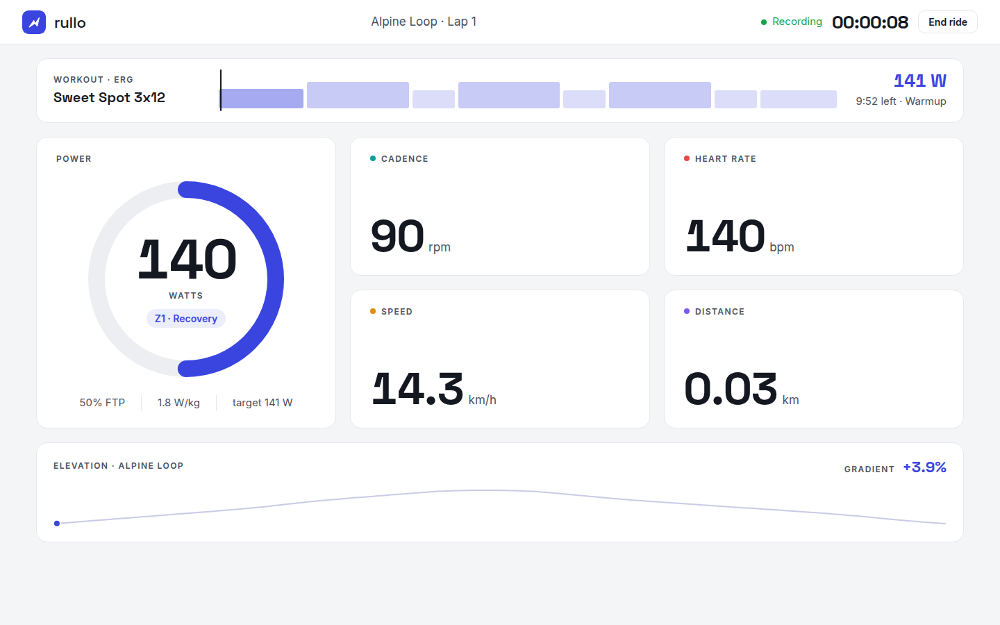
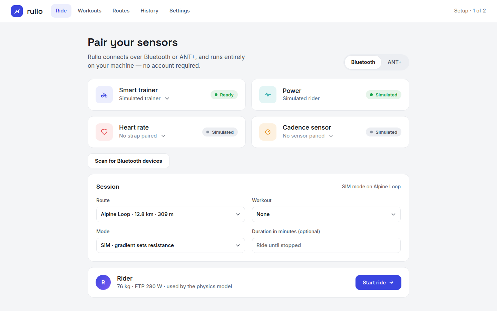
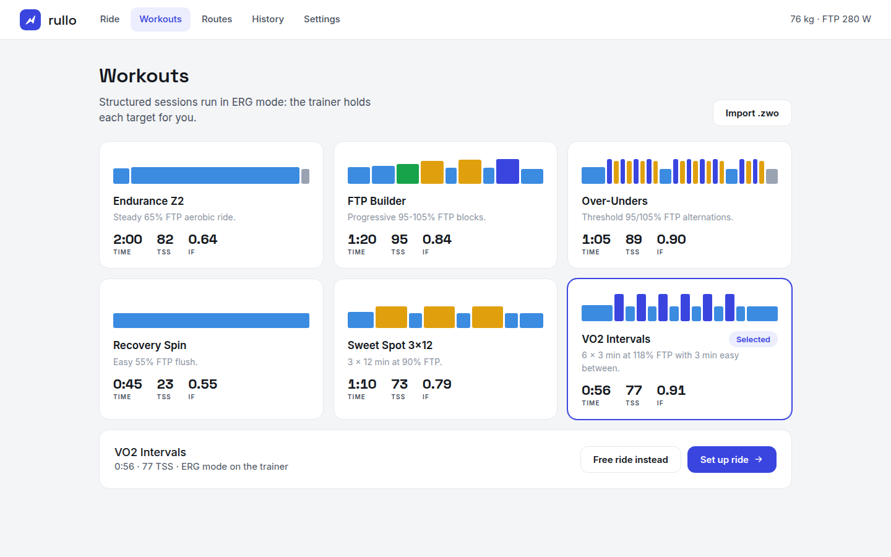
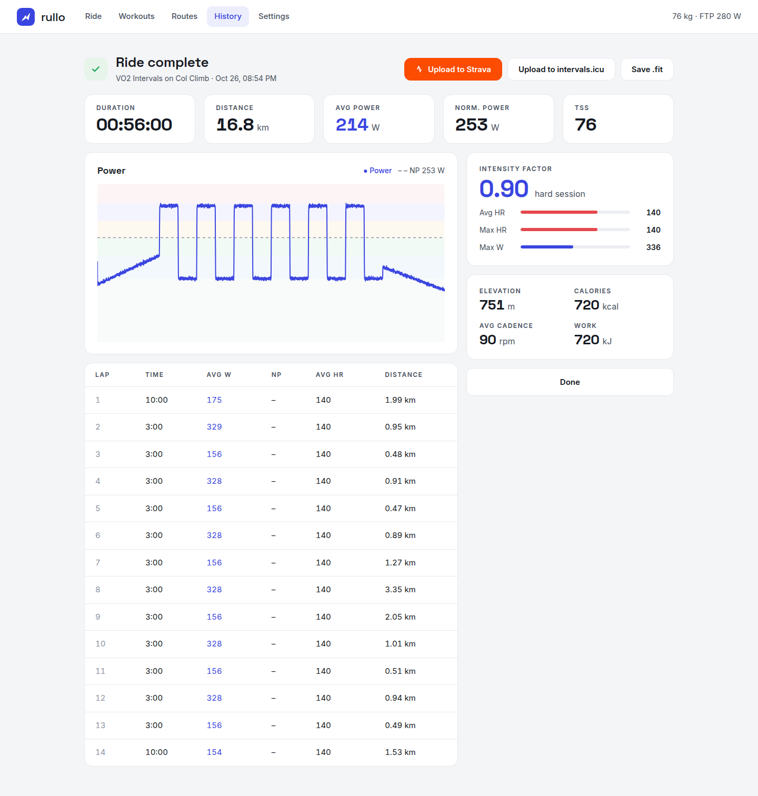
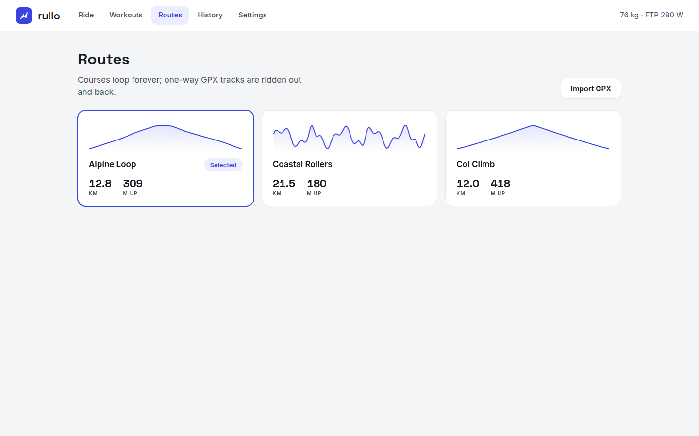
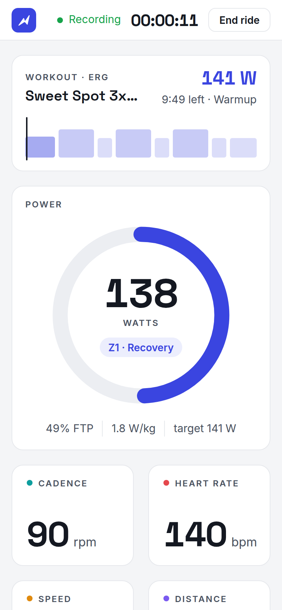

# Rullo

Rullo is a solo, offline indoor-cycling training app for Linux and an open
alternative to Zwift. It controls a smart trainer over Bluetooth (FTMS, or Wahoo KICKR on older
firmware) or ANT+ FE-C (or a simulated one), turns your power into speed with a deterministic physics model over a real
elevation profile, and records every ride to a `.fit` file you can upload to
Strava or intervals.icu.



## Screenshots

| Pair sensors | Workouts |
| --- | --- |
|  |  |
| **Ride summary** | **Routes** |
|  |  |

<p align="center"></p>

## Quickstart

```sh
uv sync
uv run rullo            # opens the app at http://127.0.0.1:8765/
```

In the app:

1. **Ride**: pick the simulated trainer, or choose *Bluetooth* or *ANT+* and
   scan to find a trainer and an optional heart-rate strap and cadence sensor.
2. **Routes / Workouts**: choose a route (three demo routes are bundled; import
   your own GPX) and optionally a structured workout (`.zwo`, ERG mode).
3. **Start ride**: the HUD shows power with zones, the workout or course card,
   the live elevation profile, cadence, heart rate, speed and distance.
4. **Summary**: NP, IF, TSS and laps; *Save .fit*, *Upload to Strava* or
   *Upload to intervals.icu*. Every ride is in **History**.

Set your weight, FTP, trainer difficulty and the upload accounts in
**Settings**. For Strava, create an API application at
<https://www.strava.com/settings/api> with *Authorization Callback Domain*
`127.0.0.1`, paste its client ID and secret, then press *Connect Strava*.

### Terminal ride

```sh
uv run rullo ride --route alpine-loop --duration 300   # SIM mode on a route
uv run rullo ride --workout vo2-intervals --ftp 280    # ERG workout
uv run rullo ride --help
```

## How resistance works

In SIM mode the route gradient at your position, scaled by the difficulty
setting (default 50%, like Zwift), is sent to the trainer as FTMS *Set Indoor
Bike Simulation Parameters*. In ERG mode the workout target is sent as *Set
Target Power*, ramping at most 50 W/s; if your cadence drops below the floor
(default 55 rpm) the target is halved until you recover. Commands are sent at
most once a second.

## Files

- Settings: `~/.config/rullo/settings.json` (mode 600; holds upload tokens)
- Rides (`.fit` + summary), imported routes and workouts: `~/.local/share/rullo/`

## Development

```sh
uv run pytest
uv run ruff check . && uv run ruff format --check .
uv run mypy
```

The whole suite runs on the simulated trainer: no hardware, no network.

## Trainers

Rullo picks the protocol when it connects: FTMS if the trainer offers it,
otherwise Wahoo's own control commands (for example a KICKR SNAP on firmware
2.x). The Wahoo commands follow open-source implementations, since Wahoo does
not publish them. The KICKR SNAP does not report cadence, so pair a Bluetooth
cadence sensor if you want it.

### ANT+

ANT+ needs a USB stick (for example a Garmin/Dynastream ANT USB-m). Rullo
supports FE-C trainers (resistance control), ANT+ power meters (power only),
heart-rate straps and cadence sensors, all on the same stick. A ride uses one
radio: pair the trainer and its sensors all over Bluetooth or all over ANT+.

On Linux, give your user access to the stick once:

```sh
echo 'SUBSYSTEM=="usb", ATTRS{idVendor}=="0fcf", ATTRS{idProduct}=="1004|1008|1009", TAG+="uaccess"' \
  | sudo tee /etc/udev/rules.d/42-ant-usb-sticks.rules
sudo udevadm control --reload-rules && sudo udevadm trigger
```

Then unplug and replug the stick.

### Troubleshooting

If the scan does not find your trainer, make sure it is not connected in your
system Bluetooth settings or in another app (Wahoo, Zwift). A connected trainer
stops advertising.

## Status

Tested with a real KICKR SNAP (firmware 2.3.63) for scanning, connecting and
reading power. Resistance commands are covered by tests, but have not yet been
checked by riding a real trainer. ANT+ is covered by tests against a fake USB
stick only, not yet tried on real hardware. A 3D world and Flatpak packaging
are not built yet.

## Contributing

See [CONTRIBUTING.md](CONTRIBUTING.md). Trainer compatibility reports are
especially welcome. Please follow the [Code of Conduct](CODE_OF_CONDUCT.md),
and report security issues as described in [SECURITY.md](SECURITY.md).

## License

GPL-3.0-or-later. The bundled routes are synthetic demo data.

The app bundles the [Inter](https://github.com/rsms/inter) and
[Space Grotesk](https://github.com/floriankarsten/space-grotesk) fonts under the
SIL Open Font License 1.1 (license texts in `src/rullo/web/fonts/`), so it works
offline.
