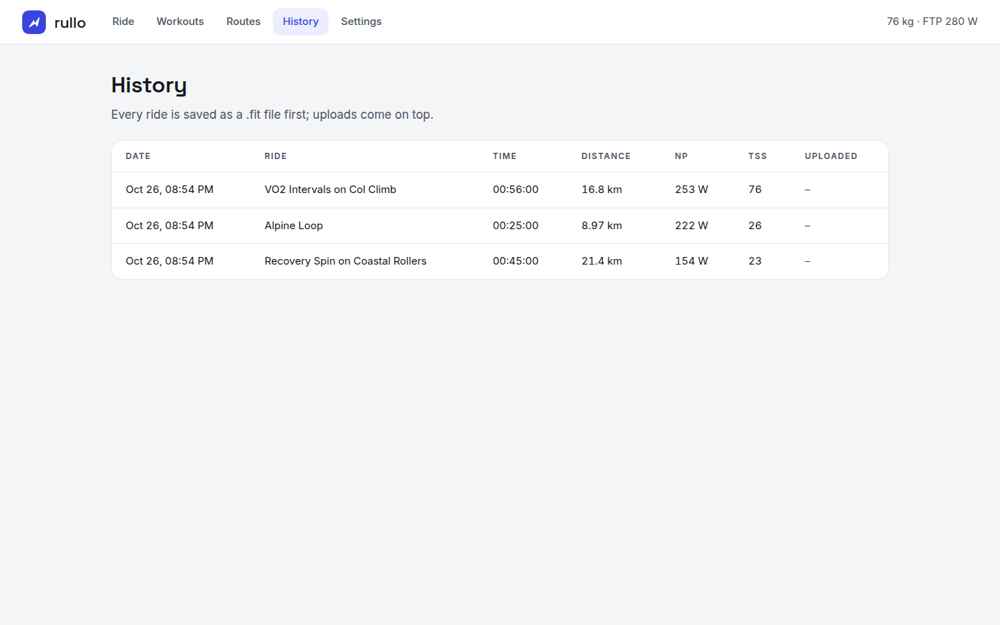

# Rullo

Rullo is a solo, offline indoor-cycling training app for Linux, macOS and
Windows, and an open alternative to Zwift. It controls a smart trainer over
Bluetooth (FTMS, Tacx FE-C, or Wahoo KICKR on older firmware) or ANT+ FE-C (or
a simulated one), turns your power into speed with a deterministic physics
model over a real elevation profile, and records every ride to a `.fit` file
you can upload to Strava or intervals.icu. No account, no cloud: everything
stays on your computer.


## Screenshots

| Pair sensors | Workouts |
| --- | --- |
|  |  |
| **Ride summary** | **Routes** |
|  |  |
| **History** | **Ride screen on a phone** |
|  |  |

## Install

Rullo is a Python app. Pick one of these:

**With Python (any OS).** Install [uv](https://docs.astral.sh/uv/), then:

```sh
uv tool install git+https://github.com/rsorrentino/rullo
rullo                   # opens the app in your browser
```

`pipx install git+https://github.com/rsorrentino/rullo` works too.

**Standalone download (no Python needed).** Each
[release](https://github.com/rsorrentino/rullo/releases) has a build per
platform. Start it and the app opens in your browser; keep the window that
appears open while you ride, and close it to quit.

- **Linux** (`rullo-linux-x86_64.tar.gz`): extract it and run `./install.sh`
  to add Rullo to your applications menu, or run `rullo/rullo` directly.
- **macOS** (`rullo-macos-arm64.zip`, Apple Silicon): unzip and double-click
  `Rullo.command`. The build is not notarised, so the first time macOS blocks
  it: open *System Settings → Privacy & Security* and choose *Open Anyway*
  (or run `xattr -dr com.apple.quarantine` on the folder). Allow Bluetooth
  when asked.
- **Windows** (`rullo-windows-x86_64.zip`): unzip and run `rullo\rullo.exe`.
  SmartScreen may warn about an unknown publisher: choose *More info → Run
  anyway*.

## Using the app

1. **Ride**: pick the simulated trainer, or choose *Bluetooth* or *ANT+* and
   scan to find a trainer and an optional heart-rate strap and cadence sensor.
2. **Routes / Workouts**: choose a route (three demo routes are bundled; import
   your own GPX) and optionally a structured workout (`.zwo`, `.erg` or
   `.mrc`), including the built-in **FTP ramp test**.
3. **Start ride** and start pedalling: the clock starts on your first pedal
   stroke. The ride screen has a power ring against your FTP, the workout
   interval strip, cadence, heart rate, speed, distance and the route profile,
   with audio cues at each block change. Pause, resume or skip a block at any
   time; the screen stays awake while you ride.
4. **Summary**: NP, IF, TSS, laps, time in power and heart-rate zones; *Save
   .fit* or *.tcx*, *Upload to Strava* or *intervals.icu*. After a ramp test,
   apply the estimated FTP with one click.
5. **History** keeps every ride (reopen or delete it), and **Progress** shows
   your power curve, an FTP estimate and your training load (fitness, fatigue
   and form).

Set your weight, FTP, max heart rate, trainer difficulty, descent feel, the
steepest pitch and the upload accounts in **Settings**. For Strava, create an
API application at <https://www.strava.com/settings/api> with *Authorization
Callback Domain* `127.0.0.1`, paste its client ID and secret, then press
*Connect Strava*.

### Terminal ride

```sh
rullo ride --route alpine-loop --duration 300   # SIM mode on a route
rullo ride --workout vo2-intervals --ftp 280    # ERG workout
rullo ride --help
```

## How resistance works

In SIM mode the route gradient at your position is scaled by the difficulty
setting (default 50%, like Zwift), descents are softened further (default
50%), and nothing steeper than the cap (default 15%) is sent to the trainer. In
ERG mode the workout target is sent as a target power, ramping at most 50 W/s;
if your cadence drops below the floor (default 55 rpm) the target is halved
until you recover. While paused, resistance eases off. Commands are sent at
most once a second.

The FTP ramp test raises the target every minute. When you stay below 85% of
the target for 10 seconds, it ends and moves on to the cool-down; your FTP is
estimated as 75% of your best minute.

## Trainers

Rullo picks the protocol when it connects: FTMS if the trainer offers it, then
Tacx FE-C over Bluetooth, otherwise Wahoo's own control commands (for example a
KICKR SNAP on firmware 2.x). The Wahoo and Tacx details follow open-source
implementations, since the vendors do not publish them. The KICKR SNAP does not
report cadence, so pair a Bluetooth cadence sensor if you want it.

### ANT+

ANT+ needs a USB stick (for example a Garmin/Dynastream ANT USB-m). Rullo
supports FE-C trainers (resistance control), ANT+ power meters (power only),
heart-rate straps and cadence sensors, all on the same stick. A ride uses one
radio: pair the trainer and its sensors all over Bluetooth or all over ANT+.
Rullo ships its own libusb, so nothing else needs installing on macOS.

- **Linux**: give your user access to the stick once, then unplug and replug it:

  ```sh
  echo 'SUBSYSTEM=="usb", ATTRS{idVendor}=="0fcf", ATTRS{idProduct}=="1004|1008|1009", TAG+="uaccess"' \
    | sudo tee /etc/udev/rules.d/42-ant-usb-sticks.rules
  sudo udevadm control --reload-rules && sudo udevadm trigger
  ```

- **Windows**: the stick needs the WinUSB driver. Install it once with
  [Zadig](https://zadig.akeo.ie/) (select the ANT stick, choose *WinUSB*,
  *Replace Driver*). This replaces the Garmin driver other ANT+ apps may use.

### Troubleshooting

If the scan does not find your trainer, make sure it is not connected in your
system Bluetooth settings or in another app (Wahoo, Zwift). A connected trainer
stops advertising.

## Files

| | Settings (mode 600; holds upload tokens) | Rides (`.fit` + summary), imported routes and workouts |
| --- | --- | --- |
| Linux | `~/.config/rullo/` | `~/.local/share/rullo/` |
| macOS | `~/Library/Application Support/Rullo/` | `~/Library/Application Support/Rullo/` |
| Windows | `%APPDATA%\Rullo\` | `%LOCALAPPDATA%\Rullo\` |

`XDG_CONFIG_HOME` and `XDG_DATA_HOME` override these on every platform.

## Development

```sh
uv sync
uv run rullo
uv run pytest
uv run ruff check . && uv run ruff format --check .
uv run mypy
```

The whole suite runs on the simulated trainer, with no hardware and no network,
and CI runs it on Linux, macOS and Windows. To build the standalone app for
your platform:

```sh
uv sync --group packaging
uv run pyinstaller packaging/rullo.spec --noconfirm
./dist/rullo/rullo --version
```

The *Build* workflow does this on all three platforms; pushing a `v*` tag
publishes the archives as a GitHub release.

## Status

Tested with a real KICKR SNAP (firmware 2.3.63) for scanning, connecting and
reading power. Resistance commands, Tacx FE-C over Bluetooth and ANT+ are
covered by tests against fake devices, but have not yet been checked with real
hardware. The macOS and Windows builds are produced and smoke-tested by CI, not
yet by hand. A 3D world is not built yet.

## Contributing

See [CONTRIBUTING.md](CONTRIBUTING.md). Trainer compatibility reports are
especially welcome. Please follow the [Code of Conduct](CODE_OF_CONDUCT.md),
and report security issues as described in [SECURITY.md](SECURITY.md).

## License

GPL-3.0-or-later. The bundled routes are synthetic demo data.

The app bundles the [Inter](https://github.com/rsms/inter) and
[Space Grotesk](https://github.com/floriankarsten/space-grotesk) fonts under the
SIL Open Font License 1.1 (license texts in `src/rullo/web/fonts/`), so it works
offline, and libusb (LGPL-2.1) through
[libusb-package](https://github.com/pyocd/libusb-package).
